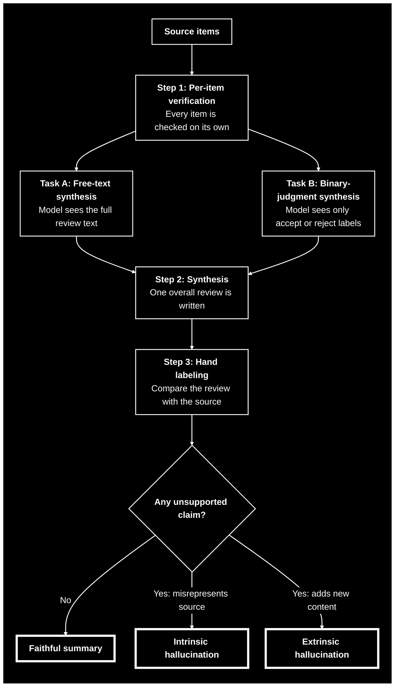

<div align="center">

# ORDB: Overall Review Detection Benchmark

### Modeling Synthesis-Stage Hallucination as a Continuous Risk Process

**Samuel Oppong Boafo**
Independent Researcher

*Working research notebook. Not peer reviewed.*

</div>

---

## Figure 1: The Studied Pipeline



*Every item is verified correctly on its own. The question is whether the final summary stays faithful to those checks.*

---

## Contents

* [Abstract](#abstract)
* [1. Introduction](#1-introduction)
* [2. Related Work](#2-related-work)
* [3. Methodology](#3-methodology)
* [4. Experimental Setup](#4-experimental-setup)
* [5. Results and Experiments](#5-results-and-experiments)
* [6. Discussion and Limitations](#6-discussion-and-limitations)
* [7. Conclusion and Future Work](#7-conclusion-and-future-work)
* [References](#references)
* [Appendix](#appendix)

---

## Abstract

Pipelines that verify many items one at a time and then merge the results into a single summary can fail at the final step even when every earlier step is correct. We call this failure synthesis-stage hallucination. It was first seen on a donation platform for university students that used Gemini to review donated items. The per-item checks were reliable, yet in 4 of 7 live batches the overall review made claims that the individual checks did not support. We ask whether this risk can be measured as a continuous process instead of being caught after the fact. To study it under controlled conditions, we built a benchmark on the Amazon Fine Food Reviews dataset (568,454 reviews, 74,258 products) and compared two task structures: free-text synthesis and binary-judgment synthesis. With Claude, free-text synthesis produced no hallucinations in 13 trials. Binary-judgment synthesis produced hallucinations in 3 of 12 trials (25%). All three fell within the 6 groups that contained at least one rejection, where the model invented a reason for the rejection that it was never given. The 6 groups in which every item was accepted produced none. Replaying the three failing prompts through Gemini produced no hallucinations, with or without the safety instruction, although only four Gemini trials were run. The samples are small, so the results show a structural pattern and not a precise rate.

**Keywords:** hallucination, synthesis, multi-step pipelines, benchmark, survival analysis, Cox proportional hazards, extrinsic hallucination

---

## 1. Introduction

### 1.1 Context and Motivation

Many real systems now work in two stages. First, a model judges each item separately. Then a second step combines those judgments into one readable output, such as an overall review, a report, or a recommendation. People tend to trust the second step because the first step was checked. That trust is only justified if the summary stays faithful to the verified inputs.

### 1.2 Problem Statement

This project began with a donation platform built for university students. The platform used Gemini to review donated items. Each item was checked on its own as acceptable or not acceptable, and then one overall review summarized the batch. The per-item checks held up well. Even so, in 4 of 7 batches, the overall review said things that the individual checks did not support. Every input was correct, and the summary was still wrong.

This raised a practical question: does the risk of this kind of error grow as more verified information is combined into a single output, and can that risk be measured before the output is shown to anyone?

### 1.3 Limitations of Existing Approaches

Existing work on hallucination in multi-step and multi-agent systems largely describes the problem through discrete structures such as states, step attribution, and verification gates. These methods are useful for finding where an error entered a workflow. They do not describe how the risk of an error may change smoothly as more content is combined.

### 1.4 Contributions

1. We describe synthesis-stage hallucination as a failure that can occur even when every upstream verification is correct.
2. We build a controlled benchmark on real data, using 568,454 Amazon Fine Food Reviews, with two task structures that separate free-text synthesis from binary-judgment synthesis.
3. We observe that, in our sample, extrinsic hallucination appeared only in groups containing at least one rejection, where the model invented a cause for it.
4. We run a cross-model check that replays Claude's failures through Gemini, with and without the safety instruction. The failures did not reproduce, which suggests that the safety instruction alone does not explain the difference.
5. We propose a continuous hazard formulation based on Cox proportional hazards modeling, and we release the code, data, and hand-labeled results.

---

## 2. Related Work

**Multi-step and agentic hallucination.** Zhang et al. (2024) show that language models can snowball: after committing to an early mistake, they justify it with further false claims. AgentHallu (Liu et al., 2026) is a benchmark for attributing a hallucination to the step in an agent trajectory where it first appears. VERIMAP (Xu et al., 2026) attaches verification checks to each subtask of a multi-agent plan. CaveAgent (Ran et al., 2026) keeps state in a persistent runtime to reduce errors such as invented tool parameters. These approaches are strong at locating where a mistake enters a workflow.

**Confidence under distraction.** CaliDist (Jawad and Caragea, 2026) calibrates language models through their behavioral robustness to distraction. It is related to our setting, because a summary step also has to handle many pieces of information at once.

**Survival analysis.** Hazard-function modeling has been used to monitor machine learning systems in general, for example when tracking data drift. Survival analysis has also been used to study how long a language model stays consistent under adversarial attack (Li et al., 2026). To our knowledge, it has not been applied to hallucination in synthesis steps.

**Hallucination taxonomy.** We follow the distinction between intrinsic and extrinsic hallucination used in MiRANews (Xu et al., 2021), which adopts it from Maynez et al. (2020). Intrinsic hallucination misrepresents something in the source. Extrinsic hallucination adds something with no basis in the source.

**Research gap.** Existing work describes multi-step hallucination with discrete structures. This work proposes a continuous alternative, in which risk is a function of how much information is combined and how varied that information is.

---

## 3. Methodology

### 3.1 Problem Formulation

Consider a group of $n$ items. Each item $i$ has a verified input $y_i$, which is either the full review text or an accept or reject label. A synthesis step $f$ produces one overall output:

$$O = f(y_1, y_2, \ldots, y_n)$$

We define a hallucination indicator $H(O) = 1$ if $O$ contains at least one claim that is not supported by $\{y_1, \ldots, y_n\}$, and $H(O) = 0$ otherwise. Each hallucination is then classified as intrinsic or extrinsic.

### 3.2 Task Structures

* **Free-text synthesis.** The model receives the full text of several reviews for one product and writes one overall review.
* **Binary-judgment synthesis.** The model receives only accept or reject labels for the items in a group and writes one overall review. This mirrors the structure of the donation platform, where the summary step works from per-item accept or reject judgments.

### 3.3 Proposed Hazard Formulation

To treat risk as continuous, we let context size play the role of time. Let $n$ be the number of aggregated items and $x$ a vector of covariates, such as input variance and the number of rejections. The hazard of a first hallucination is:

$$\lambda(n \mid x) = \lambda_0(n)\,\exp(\beta^{\top} x)$$

The survival function $S(n) = P(\text{no hallucination up to context size } n)$ then gives the chance that a summary of that size stays faithful. This is the standard Cox proportional hazards form (Cox, 1972), applied here with context size in place of time.

> **Status:** The model is implemented in `scripts/cox_model_validation.py` and validated on synthetic data only. It has not yet been fit to real hallucination labels, because there are not enough real positive cases to do so responsibly.

### 3.4 Annotation Protocol

Every trial was labeled by hand. The model's synthesized output was compared against its actual source, either the real review text or the real accept and reject labels. Each hallucination was then marked as intrinsic or extrinsic using the definitions from MiRANews.

### 3.5 Training Details

No language model was trained or fine-tuned. All models were used as they are, through prompting, with prompts generated by the scripts in this repository.

---

## 4. Experimental Setup

### 4.1 Dataset

We use the [Amazon Fine Food Reviews](https://www.kaggle.com/datasets/snap/amazon-fine-food-reviews) dataset (McAuley and Leskovec, 2013), which contains 568,454 reviews of 74,258 products. Reviews were grouped by product, and every product group was recorded with its size and variance statistics in `data/product_groups_real.csv`.

A diverse set of 12 product groups, spread across sizes and variances, was selected for controlled testing. The selection is listed in `data/batch_selection.csv`.

### 4.2 Evaluation Metric

The metric is the hallucination rate: the share of trials in which the synthesized output contains at least one unsupported claim, judged by hand against the source. Because the samples are small, we also report 95% Wilson confidence intervals computed from the reported counts (see Appendix B).

### 4.3 Models and Baselines

* **Claude** was the main model for both task structures.
* **Gemini** was the model used on the original donation platform. It was used here as a cross-model check on Claude's failure cases.
* **Ablation.** The "do not invent details" safety instruction was removed from the prompt to test whether the instruction was hiding a failure.

### 4.4 Implementation Details

Prompts were built with `scripts/pipeline.py`, `scripts/binary_judgment_pipeline.py`, `scripts/prepare_synthesis_samples.py`, and `scripts/stripped_prompts.py`. Descriptions of every file are in [Appendix A](#a-repository-structure).

---

## 5. Results and Experiments

### 5.1 Main Results

| Test | Model | Trials | Hallucinations | Rate | 95% interval |
|---|---|---|---|---|---|
| Free-text synthesis | Claude | 13 | 0 | 0% | 0% to 23% |
| Binary-judgment synthesis, all groups | Claude | 12 | 3 | 25% | 9% to 53% |
| Binary judgment, groups with 1 or more rejections | Claude | 6 | 3 | 50% | 19% to 81% |
| Binary judgment, groups where every item was accepted | Claude | 6 | 0 | 0% | 0% to 39% |
| Binary judgment, Claude's 3 failure cases replayed | Gemini | 3 | 0 | 0% | 0% to 56% |
| Same 3 cases, safety instruction removed | Gemini | 1 | 0 | 0% | 0% to 79% |

Only 4 Gemini trials exist in total, so the Gemini rows are indicative and not conclusive.

**Figure 2: Hallucination rate with 95% Wilson intervals.**

```
                              0%        25%       50%       75%       100%
                              ┼─────────┼─────────┼─────────┼─────────┼
Free text (0/13)              ├────────┤                                 0%
Binary, all groups (3/12)     ██████████───────────┤                     25%
Binary, 1+ rejection (3/6)    ████████████████████────────────┤          50%
Binary, all accepted (0/6)    ├───────────────┤                          0%
Gemini replay (0/3)           ├─────────────────────┤                    0%
Gemini, no safety line (0/1)  ├───────────────────────────────┤          0%
                              ┼─────────┼─────────┼─────────┼─────────┼

█ observed rate     ├───┤ 95% Wilson interval
```

The overlapping intervals are the main reason to treat these rates with caution. For example, the 25% rate for binary judgment cannot be told apart from rates anywhere between 9% and 53%.

### 5.2 Key Findings

**Finding 1: Free-text synthesis stayed faithful.** When the model could see the full review text, it produced no hallucinations in 13 trials. Having the underlying evidence in front of it appears to keep the summary grounded.

**Finding 2: Binary-judgment synthesis failed in a specific way.** When the model saw only labels, hallucinations appeared in 3 of 12 trials. All three came from groups with at least one rejection.

**Finding 3: The rejection acts as a trigger.** In every one of the three failures, the model invented a plausible-sounding reason for the rejection, which was a cause it was never given. Groups where everything was accepted never produced a hallucination, regardless of size.

**Finding 4: The failure appears model-specific on this task.** Replaying the exact three prompts where Claude fabricated a reason through Gemini produced zero hallucinations. Removing the safety instruction did not change this. The evidence is thin, but it suggests that prompt wording alone does not explain the gap.

### 5.3 Ablation Study

Removing the instruction "do not invent details" from the prompt did not cause Gemini to fabricate a reason. With only one case tested, this is weak evidence, but it points away from the explanation that Gemini was simply protected by that line.

### 5.4 Qualitative Analysis

All hallucinations found in this work were extrinsic, and the pattern was consistent. The model was told that an item was not acceptable and nothing more, and its overall review then supplied a cause as though that cause had been part of the input. Two files record the first trial of each kind: `results/real_label_001_B0026LH22U.json` for free-text synthesis and `results/real_label_binary_001.json` for the first binary-judgment hallucination found.

---

## 6. Discussion and Limitations

### 6.1 Interpretation

The original motivation was that risk might grow as more verified information is combined. In the groups where every item was accepted, no hallucination appeared at any size. What did appear was a dependence on what the inputs say. A group with a rejection invites the model to explain it, and when no explanation is available, the model sometimes makes one up. With only 6 groups containing rejections, this sample cannot say whether size matters within those groups. It does suggest that label composition, and not only context size, should be a covariate in any hazard model of synthesis risk.

The result also has a practical reading. If a pipeline passes only judgments to its summary step and drops the evidence behind them, the summary step is being asked to explain things it was never shown.

### 6.2 Open Question

It is still unexplained why the original Gemini-based platform hallucinated in 4 of 7 real batches when Gemini does not reproduce the failure here. The candidates below are untested:

* The specific Gemini model version used on the platform
* The platform's full system prompt
* Whether images were passed alongside the labels
* Messier real donation data than the clean test cases used here

### 6.3 Limitations

* **Small samples.** With 12 to 25 trials per condition, the results support a visible structural pattern and not a precise rate. The confidence intervals above are wide.
* **Limited cross-model comparison.** Only 4 Gemini trials have been run, and all of them replay Claude's failures. A fuller comparison across more conditions and more models is still needed.
* **Hazard model not yet fit to real data.** The Cox model is validated on synthetic data only and awaits enough real positive cases.
* **Model settings.** Exact model versions and decoding settings are not reported in this log, so they should not be treated as controlled variables.
* **Hand labeling.** Labels were assigned by hand, and no inter-annotator agreement was measured.
* **Domain.** Food reviews and a donation platform are two different settings, and the match between them is structural and not exact.

### 6.4 Ethical Considerations and Societal Impact

In a donation or moderation setting, an invented reason for a rejection can mislead the people affected. A donor might be told their item was turned down for a flaw it never had. Systems that summarize judgments should show the real evidence, flag any explanation that was not in the inputs, and keep a human in the loop for decisions that affect people. The benchmark in this repository uses a public review dataset.

---

## 7. Conclusion and Future Work

We studied a failure in which a summary goes wrong even though every verified input was correct. On real review data, the failure appeared only when a model summarized bare accept and reject labels and at least one label was a rejection, and in every case the model invented a cause. It did not appear when the model could see full review text, and it did not reproduce when the same prompts were run through Gemini.

Future work, in order of priority:

1. Run more trials per condition, so that rates can be stated with tighter intervals.
2. Extend the cross-model comparison across more Gemini trials, more conditions, and additional models.
3. Test the untested candidates for the original platform's failures, including model version, system prompt, image inputs, and noisier data.
4. Collect enough real positive labels to fit the Cox model, with rejection count and input variance as covariates.
5. Add a second annotator and report agreement.

---

## References

1. Cox, D. R. (1972). Regression Models and Life-Tables. *Journal of the Royal Statistical Society: Series B*, 34(2), 187 to 220.
2. Jawad, M. A., and Caragea, C. (2026). CaliDist: Calibrating Large Language Models via Behavioral Robustness to Distraction. *Proceedings of the 43rd International Conference on Machine Learning*, PMLR 306, 50921 to 50944. [Proceedings page](https://proceedings.mlr.press/v306/jawad26a.html).
3. Li, Y., Krishnan, R., and Padman, R. (2026). Time-To-Inconsistency: A Survival Analysis of Large Language Model Robustness to Adversarial Attacks. *ICLR 2026*. [arXiv:2510.02712](https://arxiv.org/abs/2510.02712).
4. Liu, X., Yang, X., Li, Z., Li, P., and He, R. (2026). AgentHallu: Benchmarking Automated Hallucination Attribution of LLM-based Agents. *arXiv preprint* [arXiv:2601.06818](https://arxiv.org/abs/2601.06818).
5. Maynez, J., Narayan, S., Bohnet, B., and McDonald, R. (2020). On Faithfulness and Factuality in Abstractive Summarization. *Proceedings of the 58th Annual Meeting of the Association for Computational Linguistics*, 1906 to 1919. [ACL Anthology](https://aclanthology.org/2020.acl-main.173/).
6. McAuley, J. J., and Leskovec, J. (2013). From Amateurs to Connoisseurs: Modeling the Evolution of User Expertise through Online Reviews. *Proceedings of the 22nd International World Wide Web Conference (WWW 2013)*, 897 to 908. [arXiv:1303.4402](https://arxiv.org/abs/1303.4402). Dataset: [Amazon Fine Food Reviews](https://www.kaggle.com/datasets/snap/amazon-fine-food-reviews).
7. Ran, M., Wan, Z., Lin, C., et al. (2026). CaveAgent: Transforming LLMs into Stateful Runtime Operators. *arXiv preprint* [arXiv:2601.01569](https://arxiv.org/abs/2601.01569).
8. Wilson, E. B. (1927). Probable Inference, the Law of Succession, and Statistical Inference. *Journal of the American Statistical Association*, 22(158), 209 to 212.
9. Xu, T., Zhang, D., Mitra, K., and Hruschka, E. (2026). Verification-Aware Planning for Multi-Agent Systems. *Proceedings of the 19th Conference of the European Chapter of the Association for Computational Linguistics (Volume 1: Long Papers)*, 7528 to 7546. [ACL Anthology](https://aclanthology.org/2026.eacl-long.353/).
10. Xu, X., Dušek, O., Narayan, S., Rieser, V., and Konstas, I. (2021). MiRANews: Dataset and Benchmarks for Multi-Resource-Assisted News Summarization. *Findings of the Association for Computational Linguistics: EMNLP 2021*, 1541 to 1552. [ACL Anthology](https://aclanthology.org/2021.findings-emnlp.133/).
11. Zhang, M., Press, O., Merrill, W., Liu, A., and Smith, N. A. (2024). How Language Model Hallucinations Can Snowball. *Proceedings of the 41st International Conference on Machine Learning*, PMLR 235, 59670 to 59684. [arXiv:2305.13534](https://arxiv.org/abs/2305.13534).

---

## Appendix

### A. Repository Structure

```
scripts/
  pipeline.py                     Free-text grouping and synthesis-prompt builder (mock data included)
  binary_judgment_pipeline.py     Binary-judgment prompt builder, matched to real Amazon product groups
  cox_model_validation.py         Cox proportional hazards model, validated on synthetic data
  run_real_grouping.py            Real grouping analysis on the full 568,454-review dataset
  prepare_synthesis_samples.py    Pulls real review text and builds ready-to-send prompts
  select_batch.py                 Selects a diverse batch of real product groups across size and variance
  stripped_prompts.py             Builds prompts with the safety instruction removed, for the ablation test

data/
  product_groups_real.csv         Every product in the dataset, grouped, with size and variance statistics
  batch_selection.csv             The 12 product groups used for controlled testing

results/
  real_label_001_B0026LH22U.json  First free-text trial, hand-labeled
  real_label_binary_001.json      First binary-judgment trial, where the first real hallucination was found
  binary_trials_full.json         All 12 binary-judgment trial results
  binary_trials_summary.json      Running tally of results
```

### B. Confidence Interval Method

The 95% intervals in Section 5.1 are Wilson score intervals (Wilson, 1927), computed from the reported counts. With small samples they are wide on purpose. They are included to show how much uncertainty remains, and not to claim precision.

### C. What This Work Is Not Yet

* A peer-reviewed or published finding. This is an independent research exploration.
* A large-scale statistical result. The sample sizes support a real pattern, not a precise rate.
* A finished model comparison. A fuller comparison across more conditions is the natural next step.
* A completed hazard model on real data. The Cox model is built and validated on synthetic data only.

### D. Citation

If you build on this benchmark or on the hazard modeling approach, please cite this repository:

```bibtex
@misc{ordb_2026,
  author    = {Samuel Oppong Boafo},
  title     = {ORDB: Overall Review Detection Benchmark. Modeling Synthesis-Stage Hallucination as a Continuous Risk Process},
  year      = {2026},
  publisher = {GitHub},
  journal   = {GitHub repository}
}
```

---

*This is an evolving research log. Results will be updated as more trials are run.*
